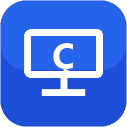
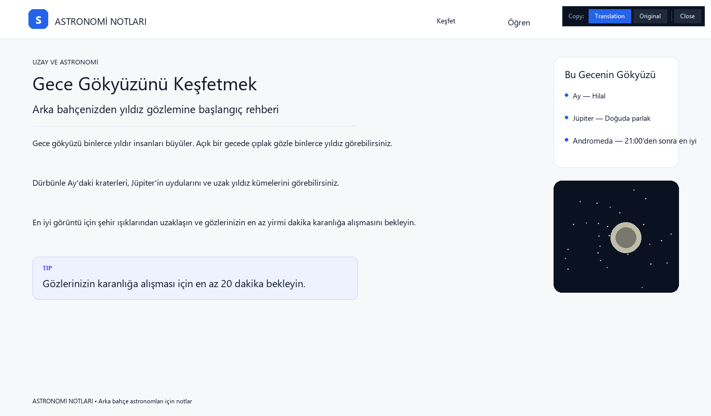
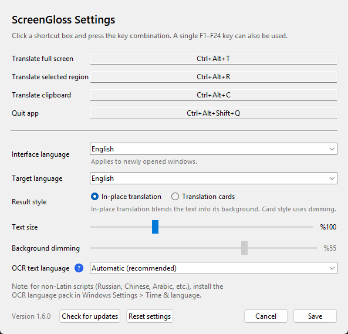

  

<h1 align="center">ScreenGloss</h1>

  <strong>Translate anything on your screen with one keystroke.</strong> 
  Windows OCR reads the text where it already is, and ScreenGloss replaces it with the translation.
  No dimming, no cards: the page looks edited in place. Close the overlay and your screen is back
  exactly as it was.

  <a href="README.md">English</a>
  &nbsp;•&nbsp;
  <a href="README.tr.md">Türkçe</a>

  
  
  

  <a href="https://github.com/mustafatire/screen-gloss-updates/releases/latest/download/ScreenGloss.exe"><strong>⬇️ Download ScreenGloss.exe</strong></a>
  &nbsp;•&nbsp;
  <a href="https://github.com/mustafatire/screen-gloss-updates/releases">All releases</a>

A Turkish page translated into English by ScreenGloss. The translation replaces the source text in place; the toolbar copies either the translation or the original, and the screen returns unchanged when you close it.

## What it does

**ScreenGloss** is a lightweight Windows screen translator. It captures the screen (or a region you
select), reads the text with the OCR engine built into Windows, translates it into one of 16
languages, and replaces the source text in place.

Because the translation stays in context, you can follow a video, a game, a PDF, a presentation, or
a foreign-language website without switching windows. There is no installer: it is a single `.exe`
that lives quietly in the system tray.

## Highlights

- **One-keystroke full-screen translation** — `Ctrl + Alt + T`
- **Region translation** — `Ctrl + Alt + R`; drag a box around just the text you need
- **Clipboard translation** — `Ctrl + Alt + C`; translate copied text in a separate window
- **16 target languages** — English, Turkish, German, French, Spanish, Italian, Russian, Arabic,
  Dutch, Portuguese, Polish, Ukrainian, Azerbaijani, Japanese, Korean, and Simplified Chinese
- **Text replaced in place** — no dimming or cards by default; press `Space` to see the original,
  `Esc` or **Close** to exit
- **Copy the translation or the original** — `Ctrl+C` / `Ctrl+Shift+C`, or the two buttons on the
  result screen
- **Translation history** — the last 50 translations, searchable and copyable from the tray menu
- **Live text-size preview** — move the slider and see the translated text size immediately on screen
- **English and Turkish interface** — follows the Windows display language, or choose manually
- **System tray app** — starts with Windows if you want, and stays out of the way
- **Automatic updates** — download and install a new version from inside the app
- **Pause shortcuts** — temporarily disable every hotkey when one conflicts with a game or another app

### What's new in 1.7.0

- **A redesigned result toolbar:** the copy and close controls now sit in a compact,
  rounded dark pill with a blue **Translation** button, a quiet **Original** button,
  a thin separator, and a small **✕**.
- **Clearer feedback:** the old **Copy:** label is gone, copy icons identify the two
  actions, buttons change color on hover, and Close turns red under the pointer.
- **Narrow mode:** tight regions collapse the toolbar to **T / O / ✕** icons; the full
  labels appear as tooltips.
- **Translation history:** **tray > Translation history** lists your last 50
  translations. Search them, copy the translation or the original, or clear the
  history. It is stored only on your computer, in the app's data folder.
- **Better OCR:** small regions are upscaled 2× before recognition and low-contrast
  images are normalized, so small and faint text is read more reliably. Full-screen
  captures are unaffected and do not get slower.
- **Text size on the result screen:** `Ctrl + +` and `Ctrl + -` redraw the translation
  at 80%–150% without changing your saved settings.
- **Unchanged behavior:** outside-strip placement, copying, `Esc`, `Ctrl+C`,
  `Ctrl+Shift+C`, `Space`/`O`, and click-does-not-close all work as before.

### What's new in 1.6.1

- **Region toolbars stay outside the box:** when you select a region, the **Copy:
  Translation**, **Copy: Original**, and **Close** buttons appear in a thin strip
  above, below, or beside the selection instead of covering it.
- **Small selections keep every button:** a short line or a small dialog now gets the
  full toolbar, not just a Close button.
- **Unchanged behavior:** the translation stays in place, and `Ctrl+C`,
  `Ctrl+Shift+C`, `Space`/`O`, `Esc`, and click-does-not-close work as before.
- If there is not enough room outside the selection, the toolbar stays inside.

### What's new in 1.6.0

- **In-place translation is now the default:** the screen is not dimmed, and there are no
  translation cards, accent bars, or bottom hint bar. ScreenGloss cleans the original text from its
  local background and writes the translation in the same spot.
- **Text that fits naturally:** the font size comes from the original text height, the ink switches
  between light and dark based on the background, and the translation can use nearby whitespace
  without crossing neighboring text.
- **Your result style:** the **Copy/Close** toolbar stays. In **Settings > Result style**
  you can switch back to the old **Translation cards** view; the dimming slider is enabled only for
  cards.
- **Photo backgrounds:** flat pages come out clean. Text over photos or heavy textures uses a local
  soft fill, so a subtle patch may be visible.

### What's new in 1.5.1

- **Copy without losing the translation:** the result screen now has **Copy: Translation** and
  **Copy: Original** buttons, plus `Ctrl+C` and `Ctrl+Shift+C`. Copying no longer closes the screen.
- **No more accidental closes:** clicking the result screen does not dismiss it, and pressing the
  translate hotkey again keeps it open with a reminder. Use `Esc` or **Close** first.
- **Notifications stay visible:** copy confirmations and hints are drawn above the full-screen result.

## Quick start

1. **Download:** click [ScreenGloss.exe](https://github.com/mustafatire/screen-gloss-updates/releases/latest/download/ScreenGloss.exe).
2. **Run it:** double-click the file. There is no setup; ScreenGloss opens in the system tray.
3. **Translate:** bring the text you want onto the screen and press `Ctrl + Alt + T`.
4. **Close:** press `Esc` or use the **Close** button. Clicking the screen itself does not close it.

> If Windows shows “Unknown publisher”, choose **More info > Run anyway**. The executable is not
> code-signed. Only download it from this repository.

A short introduction card appears the first time. You can reopen it later from the tray menu with
**Show shortcuts**.

## Shortcuts

| Shortcut | Action |
|---|---|
| `Ctrl + Alt + T` | Translate the whole screen |
| `Ctrl + Alt + R` | Translate a region selected with the mouse |
| `Ctrl + Alt + C` | Translate the clipboard text |
| `Ctrl + Alt + Shift + Q` | Quit ScreenGloss |

> On a Turkish keyboard, `Ctrl + Alt + T` and `Ctrl + Alt + R` are also used to type `₺` and `®`.
> If you use those characters often, or another app already owns the shortcut, pick a different
> combination in Settings.

### On the result screen

- `Space` or `O` — switch between the translated screen and the original.
- `Esc` or **Close** — close the translation. A mouse click no longer closes it.
- `Ctrl + C` or **Copy: Translation** — copy all translated text to the clipboard.
- `Ctrl + Shift + C` or **Copy: Original** — copy the original on-screen text to the clipboard.
- `Ctrl + +` / `Ctrl + -` — make the translated text larger or smaller (80%–150%).
- Copying keeps the result screen open and shows a short confirmation.

The toolbar on the result screen reminds you which actions are available. If you press the translate
hotkey while a result is open, ScreenGloss keeps the result and asks you to close it with `Esc`
before starting a new translation.

## Settings

Right-click the tray icon and choose **Settings…**.

- **Shortcuts:** click a shortcut box and press the combination you want. Use a key with Ctrl, Alt,
  or Win, or a single **F1–F24** key. A bare letter is not allowed because it would block typing in
  every app. Two actions cannot share the same combination.
- **Interface language:** **Automatic (Windows)**, English, or Turkish. The change applies to newly
  opened windows.
- **Target language:** 16 languages, also available quickly from the tray menu. New installations
  default to the interface language; an existing target choice is preserved.
- **Result style:** **In-place translation** (default) or **Translation cards**. In-place blends the
  translation into the surrounding background; cards use dimming.
- **Text size:** 80%–150%. The translated text is previewed live on screen while you drag.
- **Background dimming:** only applies to the **Translation cards** style; it is disabled for
  in-place translation.
- **OCR text language:** leave it on **Automatic** normally. If you know the source language,
  choosing it can improve accuracy. Hover the **?** icon for details.
- **Check for updates**, **Reset settings**, and **Save** are at the bottom of the window.

  

Settings, cache, and logs are stored in `%LOCALAPPDATA%\EkranCevir`. That folder name is kept for
upgrade compatibility; your settings from earlier versions are preserved.

## Supported languages

ScreenGloss can translate **into** these 16 languages:

**English**, Turkish, German, French, Spanish, Italian, Russian, Arabic, Dutch, Portuguese, Polish,
Ukrainian, Azerbaijani, Japanese, Korean, and Chinese (Simplified).

> If the source text uses a non-Latin script (Russian, Arabic, Chinese, Japanese, Korean, etc.), add
> that language’s OCR pack in Windows **Settings > Time & language**. Without the OCR pack,
> ScreenGloss cannot read the text.

## Requirements

- **Windows 10 or 11 (64-bit)**
- **An internet connection** for translation
- No Python, no installer, no account

## Privacy and limitations

- Text is sent to Google’s public translation endpoint. If Google does not respond, ScreenGloss tries
  the MyMemory service. Keep this in mind for confidential or sensitive text.
- ScreenGloss does not require an account and shows no ads. Settings, cache, translation history,
  and logs stay in `%LOCALAPPDATA%\EkranCevir`. You can clear the history from
  **tray > Translation history**.
- DRM-protected video (Netflix, Disney+, etc.) and some exclusive full-screen games may produce a
  black capture. This is a Windows screen-capture limitation; try borderless/windowed mode.
- Very small, blurry, or low-contrast text may not be recognized. Selecting a region usually helps.
- On photos, gradients, or heavy textures, the original text is removed with a local soft fill. Flat
  pages come out clean; on photos a subtle patch may be visible.
- Very long translations may be clipped if they do not fit near the original text; translating a
  region in smaller pieces usually helps.
- Translations are machine translations and can be wrong, especially for technical terms, idioms,
  and abbreviations. Email addresses and URLs are deliberately left untranslated.
- Right-to-left layouts (Arabic, Hebrew) may not always be positioned perfectly on screen.

## Updates

- ScreenGloss checks for a new version 20 seconds after launch and then a few times a day.
- **Update now** downloads the new EXE, verifies its SHA-256 hash, replaces the running file, and
  restarts the app. Settings and cache are preserved.
- Check immediately from **tray > Updates > Check now**; automatic checks can be disabled there too.
- Update files are published in this repository’s
  [Releases](https://github.com/mustafatire/screen-gloss-updates/releases). **Old releases are never
  deleted**; every version stays archived under its own tag.
- The update source is HTTPS-only and the downloaded file must pass a SHA-256 and PE/MZ check.

> **Updating from 1.4.0 or earlier:** your existing settings are kept. The app will identify itself
> as ScreenGloss, but the EXE file may keep its old `EkranCevir.exe` name because it replaces itself
> in place. New downloads use `ScreenGloss.exe`. The update repository was renamed to
> `screen-gloss-updates`; GitHub redirects the old URL, so older versions continue to receive
> updates.

> **Updating from 1.1 or older:** automatic updates arrived in 1.2.0. Download `ScreenGloss.exe` from
> this page once and run it manually.

## About this repository

This repository hosts ScreenGloss’s automatic update files (`ScreenGloss.exe` and `latest.json`) and
this product page. Source code is not published here.

- Latest download: [ScreenGloss.exe](https://github.com/mustafatire/screen-gloss-updates/releases/latest/download/ScreenGloss.exe)
- Version archive: [Releases](https://github.com/mustafatire/screen-gloss-updates/releases)
- Türkçe sayfa: [README.tr.md](README.tr.md)

## Feedback

Use [Issues](https://github.com/mustafatire/screen-gloss-updates/issues) for bug reports, feature
requests, and questions.

---

ScreenGloss • a screen translator for Windows

