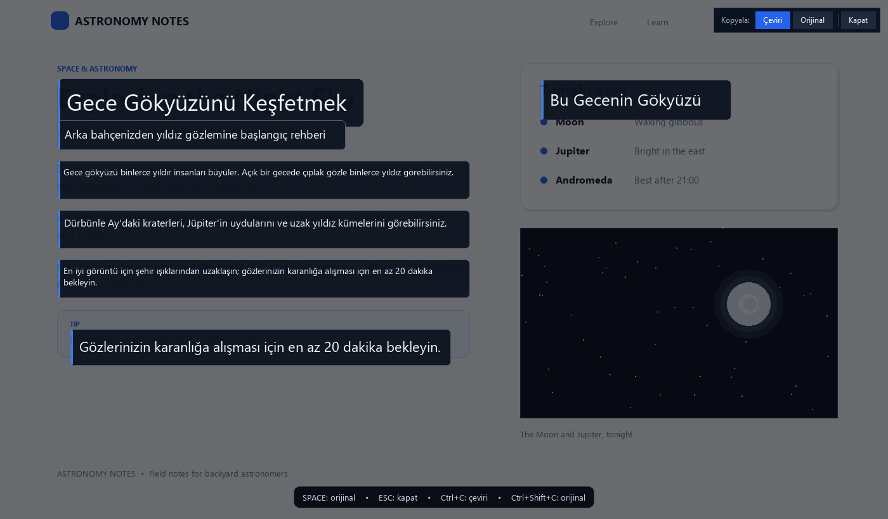
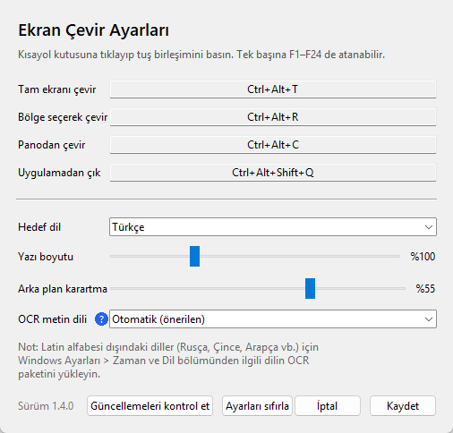

  

<h1 align="center">ScreenGloss</h1>

  <strong>Ekrandaki yazıları tek tuşla çevir.</strong> 
  Windows OCR metni bulunduğu yerde okur, ScreenGloss çeviriyi tam oraya yazar.
  Karartma ve kart yok; sayfa yerinde değiştirilmiş gibi görünür. Sonuç ekranını
  kapattığınızda ekran eski hâline döner.

  <a href="README.md">English</a>
  &nbsp;•&nbsp;
  <a href="README.tr.md">Türkçe</a>

  
  
  

  <a href="https://github.com/mustafatire/screen-gloss-updates/releases/latest/download/ScreenGloss.exe"><strong>⬇️ ScreenGloss.exe'yi indir</strong></a>
  &nbsp;•&nbsp;
  <a href="https://github.com/mustafatire/screen-gloss-updates/releases">Tüm sürümler</a>

İngilizce bir sayfa Türkçeye çevrilmiş hâlde. Çeviri, kaynak metnin tam yerine yazılır; üstteki araç çubuğu çeviriyi veya orijinali kopyalar, kapattığınızda ekran eski hâline döner.

## Nedir?

**ScreenGloss**, Windows için hafif bir ekran çevirmenidir. Ekranın tamamını veya fareyle seçtiğiniz
bir bölgeyi yakalar, metni Windows'un yerleşik OCR motoruyla okur, 16 dilden birine çevirir ve
sonucu doğrudan orijinal metnin yerine yazar.

Çeviri bağlamın içinde kaldığı için video, oyun, PDF, sunum veya yabancı dildeki bir web sayfasını
pencere değiştirmeden takip edebilirsiniz. Kurulum yoktur: sistem tepsisinde sessizce çalışan tek
bir `.exe` dosyasıdır.

## Öne çıkanlar

- **Tek tuşla tam ekran çeviri** — `Ctrl + Alt + T`
- **Bölge seçerek çeviri** — `Ctrl + Alt + R`; fareyle istediğiniz alanı seçin
- **Panodan çeviri** — `Ctrl + Alt + C`; kopyaladığınız metni ayrı pencerede çevirin
- **16 hedef dil** — Türkçe, İngilizce, Almanca, Fransızca, İspanyolca, İtalyanca, Rusça, Arapça,
  Hollandaca, Portekizce, Lehçe, Ukraynaca, Azerice, Japonca, Korece ve Basitleştirilmiş Çince
- **Yerinde çeviri** — varsayılan olarak karartma ve kart yok; `Space` ile orijinali görün,
  `Esc` veya **Kapat** ile çıkın
- **Çeviriyi veya orijinali kopyalama** — `Ctrl+C` / `Ctrl+Shift+C` ya da sonuç ekranındaki iki
  düğme
- **Canlı yazı boyutu önizlemesi** — kaydırıcıyı sürüklerken çeviri metninin boyutu ekranda anında
  görünür
- **Türkçe ve İngilizce arayüz** — Windows görüntüleme diline uyar; isterseniz elle seçin
- **Sistem tepsisi** — arka planda çalışır, isterseniz Windows ile başlar
- **Otomatik güncelleme** — yeni sürümü uygulamanın içinden indirip kurabilirsiniz
- **Kısayolları duraklat** — oyun veya başka bir programla çakışırsa tüm kısayolları geçici kapatın

### 1.6.1 yenilikleri

- **Bölge araç çubuğu kutunun dışında:** fareyle bir bölge seçtiğinizde
  **Kopyala: Çeviri**, **Kopyala: Orijinal** ve **Kapat** düğmeleri seçimin üzerine
  gelmek yerine hemen üstünde, altında veya yanında ince bir şeritte görünür.
- **Küçük seçimlerde tüm düğmeler:** kısa bir satır veya küçük bir pencere seçtiğinizde
  yalnızca Kapat değil, tam araç çubuğu görünür.
- **Değişmeyen davranış:** çeviri yine yerinde kalır; `Ctrl+C`, `Ctrl+Shift+C`,
  `Space`/`O`, `Esc` ve fareyle tıklayınca kapanmama aynı çalışır.
- Seçimin dışında yeterli alan yoksa araç çubuğu seçimin içinde kalır.

### 1.6.0 yenilikleri

- **Yerinde çeviri varsayılan oldu:** ekran karartılmıyor; çeviri kartı, mavi şerit ve alttaki
  ipucu çubuğu gösterilmiyor. Orijinal metin çevresindeki zeminle temizlenip çeviri aynı yere
  yazılıyor.
- **Doğal boyut ve renk:** yazı boyutu orijinal metnin yüksekliğinden hesaplanıyor; açık zemine
  koyu, koyu zemine açık yazı seçiliyor.
- **Komşulara taşmama:** çeviri, yakınındaki metinlere girmeden çevresindeki boşluğa yayılabiliyor.
- **Seçim sizin:** **Kopyala/Kapat** araç çubuğu duruyor. Ayarlar > **Sonuç görünümü**
  bölümünden eski **Çeviri kartları** görünümüne dönebilirsiniz; karartma kaydırıcısı yalnızca kart
  görünümünde etkindir.
- **Fotoğraf zeminleri:** düz sayfalar temiz görünür. Fotoğraf veya yoğun doku üzerinde yerel
  yumuşak dolgu kullanılır; hafif bir yama fark edilebilir.

### 1.5.1 yenilikleri

- **Çeviriyi kaybetmeden kopyalama:** sonuç ekranında **Kopyala: Çeviri** ve **Kopyala: Orijinal**
  düğmeleri ile `Ctrl+C` ve `Ctrl+Shift+C` var. Kopyalama ekranı artık kapatmıyor.
- **Kazara kapanma yok:** sonuç ekranına tıklamak onu kapatmıyor; çeviri kısayoluna yeniden
  basıldığında da ekran açık kalıyor ve önce kapatmanız hatırlatılıyor. Çıkmak için `Esc` veya
  **Kapat** kullanın.
- **Bildirimler görünür:** kopyalama onayları ve ipuçları tam ekran sonuç ekranının üstünde
  gösteriliyor.

## Hızlı başlangıç

1. **İndirin:** [ScreenGloss.exe](https://github.com/mustafatire/screen-gloss-updates/releases/latest/download/ScreenGloss.exe) dosyasına tıklayın.
2. **Çalıştırın:** İndirilen dosyaya çift tıklayın. Kurulum yoktur; uygulama sistem tepsisinde açılır.
3. **Çevirin:** Çevirmek istediğiniz metni ekrana getirip `Ctrl + Alt + T` tuşlarına basın.
4. **Kapatın:** `Esc` veya **Kapat** düğmesi. Ekrana fareyle tıklamak artık kapatmaz.

> Windows "Bilinmeyen yayıncı" uyarısı gösterirse **Ek bilgi > Yine de çalıştır** seçeneğini
> kullanın. Dosya imzasızdır; yalnızca bu depodan indirin.

İlk açılışta kısa bir tanıtım kartı görünür. Tepsi menüsündeki **Kısayolları göster** ile bu kartı
daha sonra yeniden açabilirsiniz.

## Kısayollar

| Kısayol | İşlev |
|---|---|
| `Ctrl + Alt + T` | Tüm ekranı çevir |
| `Ctrl + Alt + R` | Fareyle seçilen bölgeyi çevir |
| `Ctrl + Alt + C` | Panodaki metni çevir |
| `Ctrl + Alt + Shift + Q` | Uygulamadan çık |

> `Ctrl + Alt + T` ve `Ctrl + Alt + R`, Türkçe klavyede sırasıyla `₺` ve `®` üretmek için de
> kullanılır. Bu tuşları sık kullanıyorsanız ya da başka bir program aynı kısayolu kullanıyorsa
> Ayarlar'dan farklı bir birleşim seçin.

### Sonuç ekranı

Çeviri göründüğünde:

- `Space` veya `O` — orijinal ekran ile çeviri arasında geçiş yapın.
- `Esc` veya **Kapat** — çeviriyi kapatın. Fareyle tıklamak artık kapatmaz.
- `Ctrl + C` veya **Kopyala: Çeviri** — tüm çevrilmiş metni panoya kopyalayın.
- `Ctrl + Shift + C` veya **Kopyala: Orijinal** — ekrandaki orijinal metni panoya kopyalayın.
- Kopyalama sonuç ekranını açık tutar ve kısa bir onay gösterir.

Sonuç ekranındaki araç çubuğu kullanılabilecek işlemleri hatırlatır. Sonuç ekranı açıkken çeviri
kısayoluna basarsanız ScreenGloss ekranı korur ve yeni çeviri için önce `Esc` ile kapatmanızı ister.

## Ayarlar

Tepsi simgesine sağ tıklayıp **Ayarlar…** bölümünü açın.

- **Kısayollar:** Kısayol kutusuna tıklayıp istediğiniz tuş birleşimini basın. Ctrl, Alt veya Win
  ile birlikte bir tuş ya da tek başına **F1–F24** kullanılabilir. Tek başına harf atanamaz (o harf
  tüm programlarda yazmayı engellerdi). Aynı birleşim iki işleve atanamaz.
- **Arayüz dili:** **Otomatik (Windows)**, Türkçe veya İngilizce. Değişiklik yeni açılan
  pencerelerde geçerli olur.
- **Hedef dil:** 16 dil arasından seçilir; tepsi menüsünden de hızlıca değiştirilebilir. Yeni
  kurulumlarda varsayılan, arayüz dilidir; mevcut hedef dil seçiminiz korunur.
- **Sonuç görünümü:** **Yerinde çeviri** (varsayılan) veya **Çeviri kartları**. Yerinde çeviri,
  metni çevredeki zeminle değiştirir; kart görünümü karartma kullanır.
- **Yazı boyutu:** %80–%150. Kaydırıcıyı sürüklerken çeviri metninin boyutu ekran üzerinde canlı
  olarak önizlenir.
- **Arka plan karartma:** Yalnızca **Çeviri kartları** görünümünde etkindir; yerinde çeviride
  devre dışıdır.
- **OCR metin dili:** Normalde **Otomatik** bırakın. Kaynak dili biliyorsanız seçmek doğruluğu
  artırabilir. Ayrıntılar için **?** simgesinin üzerine gelin.
- **Güncellemeleri kontrol et**, **Ayarları sıfırla** ve **Kaydet** pencerenin altındadır.

  

Ayar, önbellek ve günlük dosyaları `%LOCALAPPDATA%\EkranCevir` klasöründe tutulur. Bu klasör adı,
önceki sürümlerden sorunsuz yükseltme için korunmuştur; eski ayarlarınız kaybolmaz.

## Desteklenen diller

ScreenGloss şu **16 dile** çeviri yapabilir:

**Türkçe**, İngilizce, Almanca, Fransızca, İspanyolca, İtalyanca, Rusça, Arapça, Hollandaca,
Portekizce, Lehçe, Ukraynaca, Azerice, Japonca, Korece ve Basitleştirilmiş Çince.

> Kaynak metin Latin alfabesi dışındaysa (Rusça, Arapça, Çince, Japonca, Korece vb.) Windows
> Ayarları > **Zaman ve dil** bölümünden ilgili dilin OCR paketini eklemeniz gerekir. OCR paketi
> olmadan ScreenGloss bu metni okuyamaz.

## Gereksinimler

- **Windows 10 veya 11 (64 bit)**
- **İnternet bağlantısı** (çeviri için)
- Python, kurulum veya hesap gerekmez

## Gizlilik ve sınırlamalar

- Metinler çeviri için Google'ın herkese açık çeviri uç noktasına gönderilir. Google yanıt vermezse
  MyMemory servisi denenir. Gizli veya hassas metinlerde bunu göz önünde bulundurun.
- ScreenGloss hesap açmanızı istemez ve reklam göstermez. Ayar, önbellek ve günlük dosyaları
  `%LOCALAPPDATA%\EkranCevir` klasöründe kalır.
- DRM korumalı video içerikleri (Netflix, Disney+ vb.) ve bazı tam ekran oyunlar siyah görüntü
  verebilir. Bu Windows'un ekran yakalama kısıtlamasıdır; oyunu pencereli / borderless moda alın.
- Çok küçük, bulanık veya düşük kontrastlı yazılar OCR tarafından okunamayabilir. Bölge seçimiyle
  yakınlaştırmak çoğu zaman yardımcı olur.
- Fotoğraf, gradyan veya yoğun doku üzerindeki metinlerde orijinal yazı yerel bir yumuşak dolguyla
  temizlenir. Düz sayfalar temizdir; fotoğraf üzerinde hafif bir yama görülebilir.
- Çok uzun çeviriler orijinal metnin yakınına sığmazsa kesilebilir; bölgeyi parça parça çevirmek
  daha iyi sonuç verir.
- Çeviriler makine çevirisidir; teknik terimlerde, deyimlerde ve kısaltmalarda hata olabilir.
  E-posta adresleri ve web adresleri bilinçli olarak çevrilmeden bırakılır.
- Sağdan sola yazılan dillerin (Arapça, İbranice) yerleşimi ekranda her zaman doğru görünmeyebilir.

## Güncellemeler

- ScreenGloss açılıştan 20 saniye sonra ve günde birkaç kez yeni sürüm kontrolü yapar.
- **Şimdi güncelle** yeni EXE'yi indirir, SHA-256 özetini doğrular, çalışan dosyayı değiştirir ve
  uygulamayı yeniden başlatır. Ayarlarınız ve önbelleğiniz korunur.
- Hemen kontrol etmek için **tepsi > Güncellemeler > Şimdi kontrol et**; otomatik kontrolü aynı
  menüden kapatabilirsiniz.
- Güncelleme dosyaları bu depodaki
  [Releases](https://github.com/mustafatire/screen-gloss-updates/releases) bölümünde yayınlanır.
  **Eski sürümler silinmez**; her sürüm kendi etiketiyle arşivde kalır.
- Güncelleme adresi yalnızca HTTPS kullanır; indirilen dosya SHA-256 ve PE/MZ denetiminden geçer.

> **1.4.0 ve öncesinden güncelleme:** Mevcut ayarlarınız korunur. Uygulama kendini ScreenGloss
> olarak gösterir; ancak dosyayı yerinde değiştirdiği için EXE'nin adı `EkranCevir.exe` olarak
> kalabilir. Yeni indirmelerde dosya adı `ScreenGloss.exe` olur. Güncelleme deposu
> `screen-gloss-updates` adına taşındı; GitHub eski adresi yeni adrese yönlendirdiği için eski
> sürümler de güncelleme almaya devam eder.

> **1.1 veya daha eski bir sürümden güncelleme:** Otomatik güncelleme ilk kez 1.2.0'da geldi. Bu
> sayfadaki `ScreenGloss.exe` dosyasını bir kez elle indirip çalıştırın.

## Bu depo hakkında

Bu depo, ScreenGloss'un otomatik güncelleme dosyalarını (`ScreenGloss.exe` ve `latest.json`) ve bu
tanıtım sayfasını barındırır. Kaynak kod bu depoda yayınlanmaz.

- Son sürümü indir: [ScreenGloss.exe](https://github.com/mustafatire/screen-gloss-updates/releases/latest/download/ScreenGloss.exe)
- Sürüm arşivi: [Releases](https://github.com/mustafatire/screen-gloss-updates/releases)
- English page: [README.md](README.md)

## Geri bildirim

Hata bildirimi, öneri veya soru için
[Issues](https://github.com/mustafatire/screen-gloss-updates/issues) bölümünü kullanabilirsiniz.

---

ScreenGloss • Windows için ekran çevirmeni

